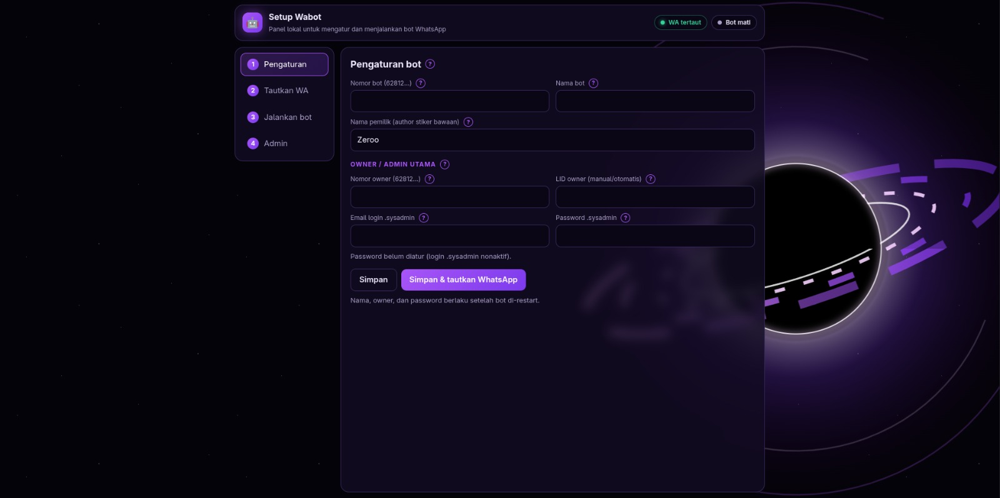
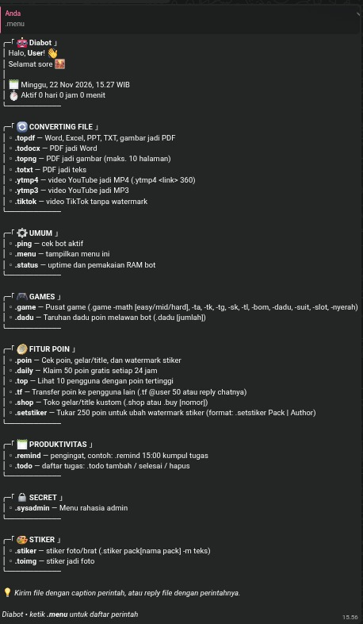

# 🤖 Diabot

Bot WhatsApp serbaguna berbasis [Baileys](https://github.com/WhiskeySockets/Baileys). Bisa membuat stiker, mengubah format file, mengunduh video YouTube/TikTok, bermain game dengan sistem poin, dan membantu produktivitas (pengingat dan daftar tugas).

> ⚠️ **Baca dulu:** proyek ini tidak berafiliasi dengan WhatsApp/Meta. Memakai klien tidak resmi bisa melanggar Ketentuan Layanan WhatsApp dan berisiko membuat nomor **diblokir**. Pakai **nomor cadangan**, jangan nomor utama.

## Daftar isi

- [Fitur](#-fitur)
- [Yang kamu butuhkan](#-yang-kamu-butuhkan)
- [Instalasi](#-instalasi)
  - [Linux: Debian / Ubuntu / Linux Mint](#linux-debian--ubuntu--linux-mint)
  - [Linux: Fedora](#linux-fedora)
  - [Linux: Arch / Manjaro](#linux-arch--manjaro)
  - [Windows (lewat WSL2)](#windows-lewat-wsl2)
- [Pasang bot](#-pasang-bot)
- [Cara pakai](#-cara-pakai)
- [Panduan admin](#-panduan-admin)
- [Menjalankan 24 jam](#-menjalankan-24-jam)
- [Struktur proyek](#-struktur-proyek)
- [Menambah perintah sendiri](#-menambah-perintah-sendiri)
- [Masalah umum](#-masalah-umum)
- [Keamanan](#-keamanan)

## ✨ Fitur

| Kategori | Perintah | Fungsi |
|---|---|---|
| Umum | `.menu`, `.ping`, `.status` | Daftar perintah, cek bot hidup, uptime dan pemakaian RAM |
| Stiker | `.stiker`, `.brat`, `.toimg` | Foto jadi stiker (bisa pakai teks), stiker gaya "brat", stiker jadi foto |
| Converter | `.topdf`, `.todocx`, `.topng`, `.totxt` | Word/Excel/PPT/gambar jadi PDF, PDF jadi Word/gambar/teks |
| Downloader | `.ytmp4`, `.ytmp3`, `.tiktok` | Video/audio YouTube, video TikTok tanpa watermark |
| Poin | `.poin`, `.daily`, `.top`, `.tf`, `.shop`, `.setstiker` | Saldo, klaim harian, peringkat, transfer, toko gelar, watermark stiker |
| Game | `.game`, `.dadu` | Matematika, tebak angka/kata/gambar/lirik, susun kata, bom, suit, slot, dadu |
| Produktivitas | `.remind`, `.todo` | Pengingat dan daftar tugas pribadi |
| Admin | `.sysadmin` | Menu rahasia admin (kelola poin dan admin) |

## 🧰 Yang kamu butuhkan

Bot ini memakai beberapa program pendukung. Jangan khawatir, semuanya dipasang lewat perintah di bagian [Instalasi](#-instalasi).

| Program | Dipakai untuk | Wajib? |
|---|---|---|
| **Node.js 20 atau lebih baru** | Menjalankan bot | Wajib |
| **Git** | Mengunduh proyek ini | Wajib (atau unduh ZIP dari GitHub) |
| **Python 3 + venv** | Tempat `yt-dlp` dan `pdf2docx` | Wajib untuk downloader dan `.todocx` |
| **ffmpeg** | Menggabungkan video dan membuat MP3 | Wajib untuk `.ytmp4` dan `.ytmp3` |
| **LibreOffice** | `.topdf` dari Word/Excel/PPT | Wajib untuk `.topdf` |
| **poppler-utils** | `.topng` dan `.totxt` | Wajib untuk dua perintah itu |
| **Font tambahan** | Pilihan font di stiker | Opsional |
| **Nomor WhatsApp cadangan** | Dijadikan akun bot | Wajib |

> 💡 Tidak semua program harus ada. Kalau kamu tidak butuh fitur tertentu, bot tetap jalan, hanya perintah terkait yang akan gagal.

## 📦 Instalasi

Pilih sesuai sistem operasimu. Semua perintah diketik di **terminal**. Setelah bagian ini selesai, lanjut ke [Pasang bot](#-pasang-bot).

### Linux: Debian / Ubuntu / Linux Mint

**1. Pasang program pendukung:**

```bash
sudo apt update
sudo apt install -y git curl ffmpeg poppler-utils libreoffice python3 python3-venv fonts-liberation fonts-comic-neue
```

**2. Pasang Node.js lewat nvm.** Versi Node di repositori Ubuntu/Debian sering terlalu lama, jadi pakai nvm:

```bash
curl -o- https://raw.githubusercontent.com/nvm-sh/nvm/v0.40.3/install.sh | bash
```

Tutup lalu buka lagi terminalmu, kemudian:

```bash
nvm install --lts
node -v    # harus tampil v20 atau lebih baru
```

> Versi nvm terbaru bisa dicek di [halaman nvm](https://github.com/nvm-sh/nvm). Kalau ada versi lebih baru, ganti angka `v0.40.3` pada perintah di atas.

### Linux: Fedora

**1. Aktifkan RPM Fusion** (repositori tambahan). Ini perlu karena ffmpeg bawaan Fedora tidak mendukung MP3 dan H.264:

```bash
sudo dnf install -y https://mirrors.rpmfusion.org/free/fedora/rpmfusion-free-release-$(rpm -E %fedora).noarch.rpm
```

**2. Pasang program pendukung:**

```bash
sudo dnf install -y git curl poppler-utils libreoffice python3 python3-pip liberation-fonts
sudo dnf swap -y ffmpeg-free ffmpeg --allowerasing
```

**3. Pasang Node.js:**

```bash
curl -o- https://raw.githubusercontent.com/nvm-sh/nvm/v0.40.3/install.sh | bash
```

Tutup lalu buka lagi terminal, kemudian:

```bash
nvm install --lts
node -v    # harus tampil v20 atau lebih baru
```

### Linux: Arch / Manjaro

Arch sudah menyediakan Node.js yang baru, jadi cukup satu perintah:

```bash
sudo pacman -S --needed git nodejs npm ffmpeg poppler libreoffice-fresh python ttf-liberation
node -v    # harus tampil v20 atau lebih baru
```

> Pengguna distro lain: cari paket dengan nama yang mirip (`ffmpeg`, `poppler` / `poppler-utils`, `libreoffice`, `python3` + modul `venv`, `nodejs` versi 20+).

### Windows (lewat WSL2)

> ⚠️ **Bot ini belum bisa dijalankan langsung di Windows biasa.** Beberapa jalur file di kodenya memakai gaya Linux (misalnya `venv/bin/`). Cara termudah adalah memakai **WSL2**, yaitu Linux asli yang berjalan di dalam Windows. Gratis dan resmi dari Microsoft.

Syarat: Windows 10 (versi 2004 ke atas) atau Windows 11, dan fitur virtualisasi aktif di BIOS (biasanya sudah aktif).

**1. Pasang WSL.** Klik kanan tombol Start, pilih **Terminal (Admin)** atau **PowerShell (Admin)**, lalu ketik:

```powershell
wsl --install
```

Restart komputer kalau diminta.

**2. Buka Ubuntu.** Cari **Ubuntu** di menu Start, buka, lalu buat nama pengguna dan kata sandi Linux (ini terpisah dari akun Windows).

**3. Ikuti langkah [Linux: Debian / Ubuntu](#linux-debian--ubuntu--linux-mint)** di atas, semuanya diketik di jendela Ubuntu tadi.

**Tips WSL:**
- Simpan proyek di dalam folder Linux (misalnya `~/diabot`), **jangan** di `/mnt/c/...`. Kalau di `/mnt/c`, bot jauh lebih lambat.
- Panel setup nanti bisa dibuka dari browser Windows biasa lewat alamat `http://127.0.0.1:3000/...`.
- Ubuntu di WSL mati kalau jendela terminalnya ditutup. Untuk 24 jam, lihat bagian [Menjalankan 24 jam](#-menjalankan-24-jam).

## 🚀 Pasang bot

Langkah ini sama untuk semua sistem (di Windows, ketik di jendela Ubuntu).

**1. Unduh proyek dan pasang dependensinya:**

```bash
git clone https://github.com/Diavalga/diabot.git
cd diabot
npm install
```

**2. Siapkan alat Python** (untuk downloader YouTube/TikTok dan `.todocx`). Bot mencari alat ini di folder `venv/`:

```bash
python3 -m venv venv
./venv/bin/pip install yt-dlp pdf2docx
```

**3. Buka panel setup:**

```bash
node setup.js
```

Terminal akan menampilkan alamat seperti ini:

```
http://127.0.0.1:3000/?key=abcdef123456...
```

Salin **seluruh alamat** (termasuk `?key=...`) ke browser. Alamat ini berubah setiap kali `setup.js` dijalankan, dan hanya bisa dibuka dari komputer yang sama.

**4. Isi panel, ada 4 langkah di menu kiri:**



| Langkah | Yang dilakukan |
|---|---|
| **1. Pengaturan** | Isi nomor bot (format `62812xxxxxxx`, tanpa `+` dan tanpa `0` di depan), nama bot, nama pemilik, dan nomor owner. Email dan password `.sysadmin` boleh dikosongkan. Klik **Simpan & tautkan WhatsApp**. |
| **2. Tautkan WA** | Panel menampilkan **kode pairing**. Di HP bot: buka WhatsApp, **Perangkat tertaut**, **Tautkan perangkat**, **Tautkan dengan nomor telepon**, lalu masukkan kodenya. |
| **3. Jalankan bot** | Klik **Mulai**. Kalau status berubah jadi **Bot online**, bot siap dipakai. |
| **4. Admin** | Tambah admin tambahan (opsional). |

**5. Coba!** Dari WhatsApp lain, kirim `.menu` ke nomor bot.

### Tentang "LID owner"

WhatsApp versi baru kadang memakai **LID** (ID tersembunyi, seperti `123456789012345@lid`) sebagai pengganti nomor telepon. Bot perlu tahu keduanya supaya mengenali kamu sebagai owner.

- **Kalau nomor bot dan nomor owner sama:** LID terisi otomatis setelah WhatsApp tertaut. Tidak perlu diisi.
- **Kalau berbeda:** kirim `.poin` dari akun owner, lalu buka `data/poin.json`. Kunci yang berakhiran `@lid` adalah LID kamu. Salin angkanya saja (tanpa `@lid`) ke kolom **LID owner** di panel.

> ⚠️ Jangan kosongkan nomor owner. Isi dengan benar supaya hak admin tidak salah sasaran.

### Perubahan pengaturan

Nama bot, owner, dan password baru berlaku setelah bot **di-restart** (tombol **Mulai ulang** di panel).

### Cara lain tanpa panel

Kalau WhatsApp sudah tertaut dan `config.json` sudah terisi, bot bisa dijalankan langsung:

```bash
node index.js
```

Jalankan dari **folder utama proyek**, karena beberapa jalur file bersifat relatif.

## 📖 Cara pakai

Semua perintah diawali titik (`.`) dan jalan di chat pribadi maupun grup. Kirim `.menu` untuk melihat daftar terbaru.

Untuk perintah yang butuh file: **kirim file dengan perintah sebagai caption**, atau **reply file itu dengan perintahnya**.

### Tampilan menu

Kirim `.menu` ke bot untuk melihat daftar perintah, dikelompokkan per kategori:



| Kategori | Perintah |
|---|---|
| Converting File | `.topdf`, `.todocx`, `.topng`, `.totxt`, `.ytmp4`, `.ytmp3`, `.tiktok` |
| Umum | `.ping`, `.menu`, `.status` |
| Games | `.game`, `.dadu` |
| Fitur Poin | `.poin`, `.daily`, `.top`, `.tf`, `.shop`, `.setstiker` |
| Produktivitas | `.remind`, `.todo` |
| Stiker | `.stiker`, `.toimg` |
| Secret | `.sysadmin` (khusus admin) |

Menu juga menampilkan sapaan, tanggal dan jam, serta uptime bot. Di bagian bawah ada pengingat: kirim file dengan perintah sebagai caption, atau reply file dengan perintahnya.

### Stiker

**Foto jadi stiker:** kirim atau reply foto dengan `.stiker`.

```
.stiker
.stiker -m halo semua                 # teks di bawah
.stiker -m teks atas | teks bawah     # teks atas dan bawah
.stiker -m halo /up                   # posisi: /up, /down, /center
.stiker -m halo font=bangers          # pilih font
.stiker pack[Paket Ku] author[Aku]    # nama pack dan author khusus
.stiker 240p                          # resolusi lebih rendah (20p sampai 2160p)
.stiker 144p -pixel                   # tampilan kotak-kotak
```

Teks maksimal 100 karakter.

**Stiker brat:** teks di latar hijau.

```
.brat omong dewe lur
.bratpink halo dunia                  # pintasan warna: .bratred, .bratblue, .bratwhite, ...
.brat bg=#ff69b4 halo                 # warna hex bebas
.brat font=lobster halo
.brat halo /down
```

Teks maksimal 150 karakter.

Font yang tersedia: `sans`, `serif`, `brat`, `impact`, `anton`, `bebas`, `bangers`, `comic`, `marker`, `luckiest`, `pixel`, `lobster`. Font yang belum terpasang di komputermu akan diganti font bawaan.

**Stiker jadi foto:** reply stiker dengan `.toimg`.

### Converter file

| Perintah | Masukan | Hasil |
|---|---|---|
| `.topdf` | Word, Excel, PowerPoint, TXT, CSV, HTML, atau gambar | PDF |
| `.todocx` | PDF | Word |
| `.topng` | PDF | Gambar (10 halaman pertama) |
| `.totxt` | PDF | File teks |

### Downloader

```
.ytmp4 https://youtu.be/xxxx          # video, kualitas bawaan 480p
.ytmp4 https://youtu.be/xxxx 360      # pilihan: 144, 240, 360, 480, 720, 1080
.ytmp3 https://youtu.be/xxxx          # audio MP3
.tiktok https://vt.tiktok.com/xxxx    # TikTok tanpa watermark (singkatan: .tt)
```

Batas: video YouTube maksimal 20 menit, audio YouTube 45 menit, TikTok 10 menit. Video di atas 30 MB dikirim sebagai dokumen. Unduhan diproses satu per satu.

### Poin

Setiap pengguna baru mulai dengan 50 poin.

| Perintah | Fungsi |
|---|---|
| `.poin` | Lihat poin, gelar, dan watermark stiker |
| `.daily` | Klaim 50 poin gratis setiap 24 jam |
| `.top` | 10 pengguna dengan poin tertinggi |
| `.tf @user 50` | Transfer poin (atau reply pesannya dengan `.tf 50`) |
| `.shop` / `.buy 1` | Lihat toko gelar / beli gelar |
| `.setstiker Pack \| Author` | Bayar 250 poin untuk mengubah watermark stiker |

Gelar di toko: Sigma (150), Jawara (300), Sultan (500), Legend (1000).

### Game

Setiap permainan memakai **10 poin**. Untuk menjawab, **reply pesan soal** dari bot.

```
.game -math easy                      # matematika (easy / mid / hard)
.game -ta                             # tebak angka 1-100
.game -tk                             # tebak kata
.game -tg                             # tebak gambar
.game -sk                             # susun kata
.game -tl                             # tebak lirik
.game -bom 5                          # tebak bom di kotak 1-9
.game -suit batu                      # suit lawan bot
.game -slot                           # mesin slot
.game -nyerah                         # menyerah dari game yang berjalan
.dadu 20                              # taruhan dadu 20 poin
```

### Pengingat dan tugas

```
.remind 15:00 kumpul tugas            # jam tertentu (besok kalau sudah lewat)
.remind 30m istirahat                 # 30 menit lagi
.remind 2j cek email                  # 2 jam lagi
.remind 1d bayar tagihan              # 1 hari lagi
.remind list                          # lihat pengingat
.remind hapus 1                       # hapus pengingat nomor 1

.todo                                 # lihat daftar
.todo tambah beli susu                # tambah
.todo selesai 1                       # tandai selesai (ketik lagi untuk batal)
.todo hapus 1                         # hapus
```

Satuan waktu: `m` = menit, `j` = jam, `d` = hari. Jam seperti `15:00` mengikuti **zona waktu komputer** tempat bot berjalan.

## 🛡️ Panduan admin

Menu admin adalah `.sysadmin` (singkatan: `.secret`). Pengguna biasa hanya mendapat pesan "akses ditolak".

**Siapa yang jadi admin:**
- **Owner** (nomor dan LID yang kamu isi di panel) selalu admin.
- Admin tambahan bisa ditambah lewat panel (langkah **Admin**) atau lewat perintah `.sysadmin addadmin`.
- Kalau kamu mengisi email dan password di panel, orang lain bisa menjadi admin dengan `.sysadmin login <email> <password>`. **Kirim di chat pribadi saja**, jangan di grup.

**Perintah** (target: tag orangnya, reply pesannya, atau ketik nomornya):

| Perintah | Siapa | Fungsi |
|---|---|---|
| `.sysadmin listadmin` | Admin | Daftar admin |
| `.sysadmin cekpoin @user` | Admin | Lihat poin dan gelar pengguna |
| `.sysadmin addpoin @user 1000` | Admin | Tambah poin |
| `.sysadmin kurangpoin @user 500` | Admin | Kurangi poin |
| `.sysadmin setpoin @user 5000` | Admin | Atur poin ke angka tertentu |
| `.sysadmin addadmin @user` | Owner | Angkat jadi admin |
| `.sysadmin deladmin @user` | Owner | Copot admin |

## 🔁 Menjalankan 24 jam

Kalau panel `setup.js` ditutup (`Ctrl+C`), bot yang dijalankan lewat panel ikut mati. Supaya bot terus hidup, atur dulu lewat panel sampai WhatsApp tertaut, **matikan bot di panel dan tutup panelnya**, lalu pakai pengelola proses seperti `pm2`:

```bash
npm install -g pm2
pm2 start index.js --name diabot
pm2 save
```

Perintah berguna: `pm2 logs diabot` (lihat log), `pm2 restart diabot`, `pm2 stop diabot`.

> Satu sesi WhatsApp hanya boleh dipakai **satu** proses. Jangan jalankan bot dari panel dan dari `pm2` bersamaan.

**Windows (WSL):** Ubuntu ikut berhenti kalau semua jendelanya ditutup, jadi komputernya harus tetap menyala dan jendela Ubuntu dibiarkan terbuka. Untuk bot yang benar-benar 24 jam, lebih cocok memakai Linux di komputer atau VPS terpisah.

## 📁 Struktur proyek

```
diabot/
├── index.js          # menyambung ke WhatsApp dan memuat semua perintah
├── setup.js          # panel setup berbasis web (lokal)
├── config.json       # pengaturan (dibuat oleh panel, tidak ikut ke GitHub)
├── commands/         # satu file per kategori perintah
├── lib/              # fungsi bantu: penyimpanan, poin, admin, unduhan, tampilan
├── assets/           # opsional: banner.jpg untuk gambar di atas menu
├── screenshots/      # gambar untuk README (panel setup dan tampilan menu)
├── data/             # data pengguna (dibuat otomatis, tidak ikut ke GitHub)
├── auth_bot1/        # sesi WhatsApp (dibuat otomatis, tidak ikut ke GitHub)
└── venv/             # alat Python (yt-dlp, pdf2docx)
```

## 🧩 Menambah perintah sendiri

Buat file baru di folder `commands/`. File akan dimuat otomatis saat bot dinyalakan ulang.

```js
export const kategori = 'Kategori Saya'
export const ikon = '✨'

export const commands = [
  {
    names: ['.halo'],
    desc: 'menyapa pengguna',
    async run({ reply, nama }) {
      return reply(`Halo, ${nama}!`)
    },
  },
]
```

Fungsi `run` menerima: `sock`, `m`, `jid`, `sender`, `nama`, `cmd`, `args`, `reply`, dan `registry`.

## 🔧 Masalah umum

| Masalah | Solusi |
|---|---|
| `node: command not found` atau versi Node lama | Pasang Node 20+ lewat nvm (lihat [Instalasi](#-instalasi)), lalu cek dengan `node -v` |
| `Cannot find module ...` | Jalankan `npm install` di folder proyek |
| `Nomor bot belum diatur` | Jalankan `node setup.js` dan isi pengaturan |
| Alamat panel tidak bisa dibuka | Salin alamat **lengkap** dengan `?key=...` dari terminal. Kalau port 3000 terpakai: `SETUP_PORT=3100 node setup.js` |
| Bot tidak mengenali saya sebagai owner | Isi nomor owner dan LID owner dengan benar (lihat [LID](#tentang-lid-owner)) |
| `yt-dlp belum terpasang` | Jalankan `./venv/bin/pip install yt-dlp` dan mulai bot dari folder utama |
| Unduhan gagal | Perbarui yt-dlp: `./venv/bin/pip install -U yt-dlp` |
| `.topdf` gagal | Pastikan LibreOffice terpasang. Cek dengan `soffice --version` |
| `.topng` / `.totxt` gagal | Pasang `poppler-utils` (Arch/Fedora: `poppler`) |
| `.ytmp3` gagal atau tanpa suara | Pastikan `ffmpeg` terpasang. Di Fedora, aktifkan RPM Fusion dulu |
| Font stiker tidak sesuai pilihan | Font belum terpasang. Unduh dari [Google Fonts](https://fonts.google.com), taruh di `~/.local/share/fonts`, lalu jalankan `fc-cache -f` |
| Bot logout / sesi ditolak | Hapus folder `auth_bot1/`, lalu tautkan ulang lewat panel |
| Poin yang ditransfer ke nomor ketikan tidak masuk | Pengguna mungkin tersimpan dengan LID. Gunakan **tag** atau **reply** pesannya, jangan ketik nomornya |

## 🔒 Keamanan

- Folder `auth_bot1/` adalah **kunci masuk akun WhatsApp bot**. Siapa pun yang memilikinya bisa mengendalikan akun itu. **Jangan pernah diunggah atau dibagikan.**
- `config.json` menyimpan nomor dan password admin. Jangan di-commit.
- Folder `data/` berisi nomor dan poin pengguna. Jaga kerahasiaannya.
- Pakai password admin yang panjang dan acak, atau biarkan kosong kalau tidak butuh login `.sysadmin`.
- File `.gitignore` sudah mengecualikan semua itu. Jangan dihapus.
- Panel `setup.js` hanya bisa diakses dari komputer yang sama dan dilindungi kunci acak. Jangan bagikan alamat panel ke siapa pun.

## 📜 Lisensi dan penafian

Proyek ini tidak berafiliasi dengan WhatsApp atau Meta. Gunakan dengan risiko sendiri, sebaiknya dengan nomor cadangan.
